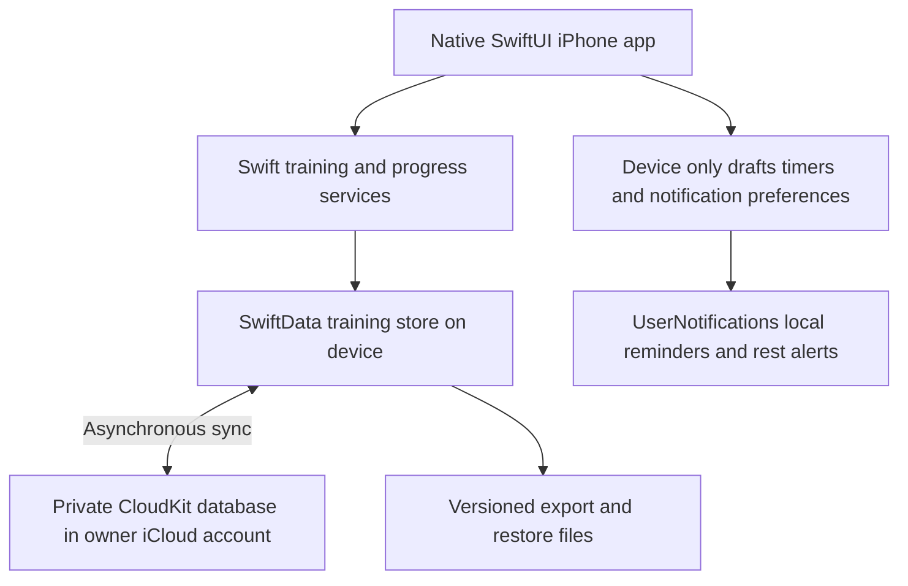

# Life Strong architecture

## Approved target October 17 2026

The owner approved replacing the Expo/Express/PostgreSQL architecture with a native SwiftUI app, local SwiftData persistence and private CloudKit synchronization. AWS integration is deferred. Phase 7A now provides a separate native rehearsal app in ios-native/ with versioned models, local saves, fixture export and automated recovery tests. The accepted TypeScript app remains the real-data baseline; legacy import/full parity and live CloudKit verification are pending. No CloudKit container has been created by Codex.

The training store is the app's durable local working copy. Reads, starting workouts, library editing and recorded results must work without a Mac/API or network. Save locally before reporting success; cloud delivery happens later and is not a prerequisite for a workout. CloudKit is the private synchronization service, not a replacement HTTP API or a PostgreSQL connection. No app-specific server login, public registration or hosted API is planned for this target.

Use SwiftUI for screens, SwiftData models/repositories with explicit save/error handling, Foundation for validation/calendar calculations, and UserNotifications for local alerts. Use a versioned schema and migration plan from the first native release. Keep notification permissions, OS notification identifiers, timers and unsaved forms device-local; they must not duplicate alerts across devices through CloudKit.

Use the owner's private CloudKit database and explicit container configuration. Proposed application identifier remains com.vineandvolt.lifestrong; proposed container is iCloud.com.vineandvolt.lifestrong, subject to the owner's Apple team registration. A separate migration rehearsal app identity/container prevents tests from replacing the accepted app or mixing test data with real data. Apple signing and entitlements are still required. The user's available iCloud capacity does not remove service/network limits or the need for exportable backups.

CloudKit-compatible models use stable domain UUIDs and optional/default-backed attributes and relationships. PostgreSQL uniqueness, foreign keys, transactions and stale-write rejection do not translate automatically into distributed guarantees. Enforce validation locally, stage imports, handle partial downloads, and verify deduplication/conflict behavior on devices. Initially one designated iPhone authors workouts/imports; unrestricted concurrent multi-device editing is excluded until tested and separately accepted.

See [migration plan](swiftdata-migration-plan.md) and [data migration contract](data-migration-contract.md) for models, conversion order, acceptance gates and rollback.

## Current implementation retained during migration

The existing frontend/ directory remains Expo SDK 57/React Native/TypeScript. backend/ remains Express/pg and database/ contains PostgreSQL migrations 001–005. Gates 1–6 were accepted for this implementation and are the native feature-parity baseline. Keep its .env files, database, volumes, queue data and working source intact. Existing npm/Docker instructions are for that legacy baseline only; they do not build the future native app.

The API continues to mediate legacy database access. Retain its auth and offline retry safeguards while it is used. deployment/ and AWS runbooks are historical fallback preparation and must not be executed for this migration. If the owner independently created billable AWS resources, simply deferring this project does not stop their charges; review them in the owner's console without deleting data or resources automatically.

## Phase 7A implementation

ios-native/LifeStrong.xcodeproj has a local LifeStrong scheme and a separate LifeStrongCloudKitRehearsal scheme. Core/ contains TrainingSchemaV1, TrainingMigrationPlan, validation, a main-actor repository with explicit save/rollback, device-local draft/pending-request storage and a six-collection diagnostic exporter. SwiftUI provides consecutive exercise creation, target workout creation, offline session start/record/pause/complete and saved-session recovery. No API or AWS call occurs in the local runtime.

Local and CloudKit rehearsal builds use distinct bundle IDs, sandbox/store paths and configuration. Cloud rehearsal compilation succeeds unsigned, but owner-operated paid signing/entitlements/container/schema/sync evidence is still required. Its runtime account-availability check and account-change UI lock are feasibility guards, not the complete 7D account-binding/privacy implementation. Only disposable fixtures belong in either rehearsal until cutover. Follow [Phase 7A testing](phase-7a-testing.md).
